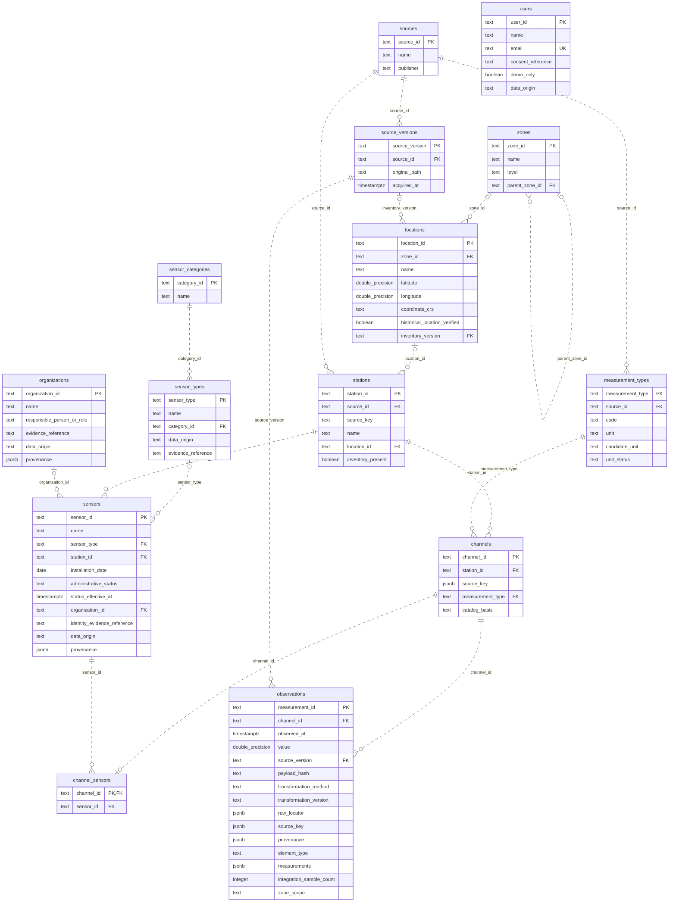

# Modelo E-R definitivo — PostgreSQL Madrid v2

Autoridad: [DDL normalizado](../../sprint1/postgres/schema_v2_3nf.sql).
Se conservan las doce entidades del núcleo y se incorporan dos tablas auxiliares:
`sensor_types` y `channel_sensors`. El esquema contiene **catorce tablas** y
diecisiete FK. Las vistas de compatibilidad no son tablas adicionales.

Cada padre admite cero a muchos hijos; una referencia opcional admite cero o un
padre por hijo. La PK de `channel_sensors` limita cada canal a una asignación.
El esquema de práctica `sprint1.readings(storage_id)` y el modelo histórico de
doce tablas están separados de esta versión.

## Relaciones y restricciones complementarias

- Estación y magnitud de un canal deben pertenecer a la misma fuente.
- Canal y snapshot de observación deben pertenecer a la misma fuente.
- Una asignación exige que canal y sensor compartan estación.
- Una zona local solo puede referenciar un distrito como padre.
- Las identidades de catálogo y los hechos observados son inmutables por UPDATE.
- `location_geography` obtiene distrito y zona; no repite distrito en ubicaciones.
- `observation_contract` reconstruye el DTO v2 sin recalcular identidades.

Las claves compuestas, los opcionales y las DF se documentan en
[normalización e impacto](../../sprint1/postgres/impacto_3nf.md). JSONB se considera
un dominio SQL tipado, sin afirmar normalización recursiva de sus componentes.
Los vínculos físicos desconocidos permanecen ausentes. Los catálogos demo no
acreditan dispositivos productores de las mediciones públicas.
