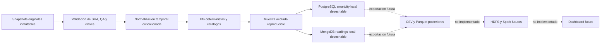
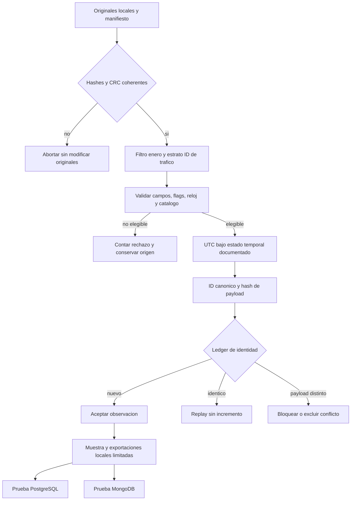
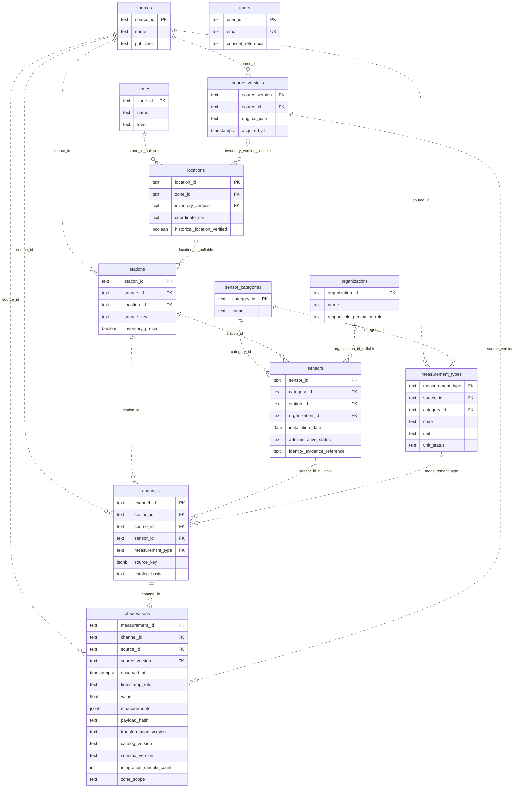
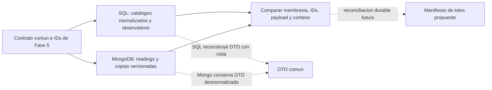
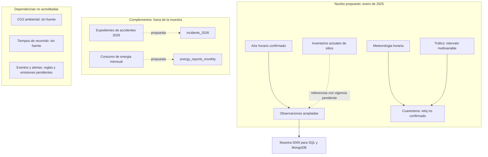

# Diagramas textuales — contrato común `smartcity`

**Modelo PostgreSQL vigente:** [E-R normalizado completo](diagrama_3nf.md),
con catorce tablas y DTO v2 compatible. Las doce tablas y diagramas siguientes
corresponden al DDL histórico conservado para reproducir sus evidencias.

Formato Mermaid versionable y renderizable en GitHub. Las flechas de flujo expresan transferencia local o propuesta, **no FK ni servicios desplegados**. El E-R histórico refleja las relaciones entre las doce tablas centrales del [DDL `smartcity`](../../research/datasets/scripts/phase5_postgresql.sql); las FK compuestas refuerzan coherencia de fuente y estación. `smartcity_demo.entities` está separado y no tiene FK al núcleo. Versión histórica: [contrato común](../equipo/CONTRATO_UNIFICADO.md).

La muestra de 5.000 de estos diagramas describe la validación inicial, no el volumen actual disponible. La [ampliación anual](../equipo/AMPLIACION_REAL_SPRINT1.md) añade una ruta configurable de todo 2025 con 1.076.813 observaciones reales y validación completa en motores locales. Meteorología y tráfico siguen separados, sin afirmar integración temporal validada.

## 1. Arquitectura de datos

La muestra CSV/Parquet local ya existe; la exportación completa desde motores y los nodos HDFS/Spark/dashboard son futuros. No representan contenedores adicionales de Compose. Fuente: [05_ingestion_plan.md](../../research/datasets/05_ingestion_plan.md).

## 2. Flujo ETL acotado y controles

Reanudación actual: reutilizar cache completa/hash válido o reconstruir determinísticamente el ledger incompleto. No se declara un checkpoint distribuido. Flags inválidos y tiempos no confirmados quedan en cuarentena referenciada; un conflicto de payload impide publicar un lote completo. Fuente: [phase5_prepare.py](../../research/datasets/scripts/phase5_prepare.py).

## 3. E-R PostgreSQL — doce tablas preliminares

Revisión PostgreSQL v2: se mantienen las mismas doce tablas y FK. La extensión
`sprint1/postgres/contract_v2.sql` añade dos atributos de observación y cambia
CHECK, no cardinalidades. [Auditoría formal](../../sprint1/postgres/normalizacion_3fn.md):
`channels` y `observations` **no cumplen 3FN estricta**; el diagrama refleja el
DDL implementado, no la descomposición propuesta.

Leyenda: `||` exactamente uno; `o|` cero o uno; `o{` cero o muchos. Se permite un padre sin hijos; una FK nullable permite hijo sin padre. Las FK NOT NULL obligan a cada hijo a un padre. Se usan relaciones no identificadoras porque las PK de los hijos son independientes de las FK. **No se infiere obligatoriedad de hijos ni unicidad uno-a-uno de la muestra.**

Este diagrama muestra atributos seleccionados, no sustituye el diccionario/DDL completo. `users` es independiente, sin FK. En la muestra histórica los maestros físicos quedaron vacíos; la entrega v2 sí carga `sensors`, `users` y `organizations` **sintéticos administrativos**, sin enlazarlos a canales observados. El trigger de fuente coherente es una restricción adicional, no otra FK. Las relaciones de `inventory_version` y unidad/tipo son las reales del DDL. Las UNIQUE compuestas y sus atributos NOT NULL están detallados en la auditoría formal; el dibujo no representa una restricción uno-a-uno por estación ni sensor.

## 4. Relación entre motores: coherencia, no FK cruzada

No se modela `SQL → MongoDB` como FK, sincronización automática o transacción distribuida. La reconciliación durable entre escrituras parciales está propuesta, no implementada remotamente.

## 5. Fuentes principales y complementarias separadas

No hay aristas de unión temporal entre 2026 y enero de 2025 ni conversión de mensual a horario. La ausencia de enlaces desde los nodos sin fuente es deliberada. Conteos y separaciones: [manifiesto de Fase 5](../../research/datasets/05_dataset_manifest.md).
