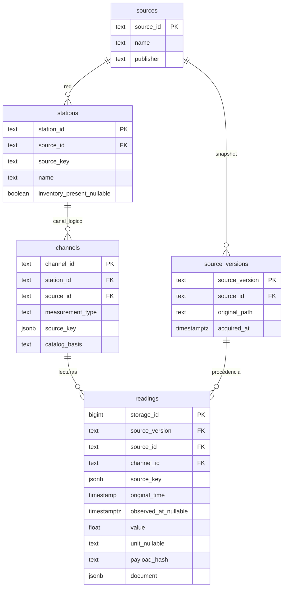

# Modelos nuevos del núcleo — revisión pendiente del equipo

Este documento describe los archivos de `sprint1/`, no reemplaza los diagramas
históricos de Fase 5 ni declara cobertura de entidades académicas ausentes.

## Relacional

`quarantine(storage_id, reason, document, received_at)` es un registro de revisión
sin FK obligatoria: debe preservar incluso payloads cuya referencia no existe.
Las FK compuestas verifican estación/red, canal/red y versión/red. La clave única
de lecturas es snapshot/canal/clave original; el ID numérico no identifica un
sensor ni depende del reloj hipotético.

### Normalización y límites

- `source_id → name, publisher`; `source_version → source_id, original_path,
  acquired_at`; `station_id → source_id, source_key, name, inventory_present`.
- `channel_id → station_id, source_id, measurement_type, source_key, catalog_basis`.
  Hay redundancia intencional `channel → station → source` para FK compuestas:
  **no afirmar 3FN estricta de este staging**. La misma red y otros metadatos se
  repiten en lecturas/JSONB para trazabilidad; los checks mantienen la proyección.
- Para el modelo definitivo 3FN se debe separar el núcleo normalizado del staging
  y eliminar dependencias transitivas, manteniendo las validaciones de red en la
  capa de carga o restricciones revisadas. No basta renombrar estas tablas.
- `document` y `source_key` son estructuras deliberadas de staging, no atributos
  académicos atómicos de un inventario físico. No acreditan por sí mismos 1FN/3FN
  de la solución final.

No se crean sensores/organismos/usuarios ficticios. Sus entidades mínimas deben
resolverse con fuentes verificables y aprobación docente antes de afirmar que el
modelo satisface el enunciado. Ubicación/zonas requieren vigencia y CRS acreditados.

## Documental

`readings` contiene un documento por lectura de trabajo: referencias a fuente,
snapshot, estación y canal; reloj original y evidencia; valor/unidad/calidad;
procedencia y payload multivariable de tráfico. No se mezclan unidades pendientes
en promedios científicos ni se crean relaciones geográficas no acreditadas.

- ObjectId: localizador interno asignado por MongoDB.
- `staging_key`: cadena canónica del DTO para idempotencia de la tupla original;
  índice único escalar, no científico ni UTC.
- `payload_hash`: huella del documento lógico antes de convertir BSON/agregar
  localizadores; no equivale al hash histórico de Fase 5.
- `quarantine`: conserva intento contradictorio e ID aceptado sin sobrescribirlo.
- Catálogos: validación explícita previa en Python; las tres entradas de prueba
  se construyen desde ejemplos solo para integración y **no son un catálogo
  independiente acreditado** para cargas reales.

Embebemos el payload de una lectura para conservar su contexto; referenciamos
catálogos que requieren revisión/versionado independiente. El esquema estricto
controla tipos/evidencia en el motor, pero no demuestra reglas de negocio que
solo comprueba el validador de aplicación.
